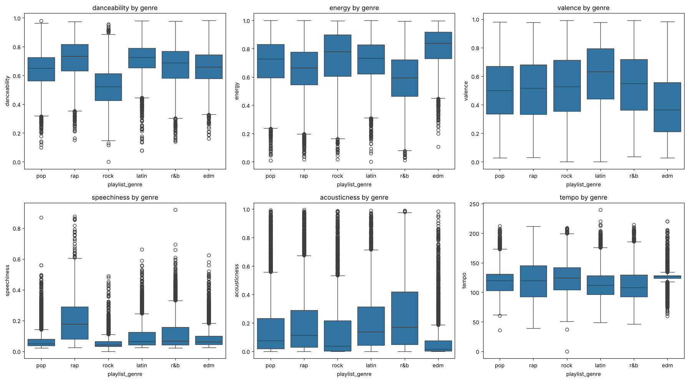
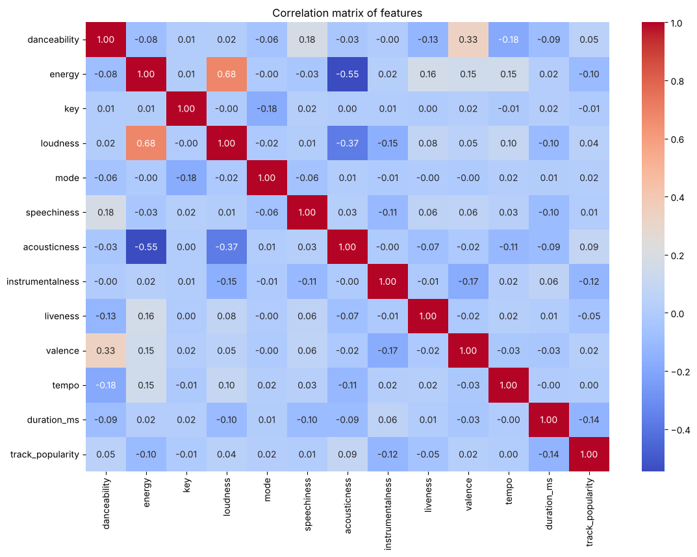
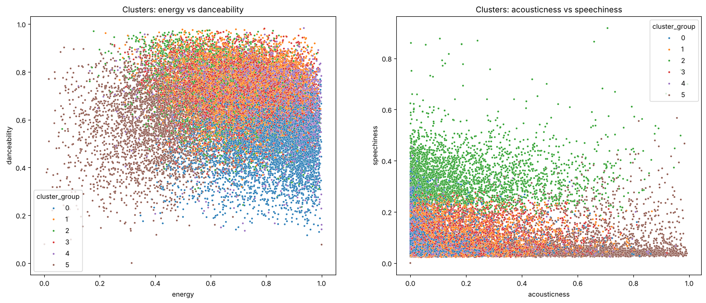
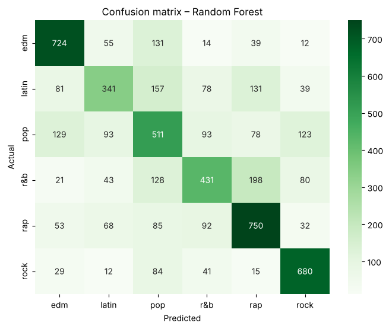
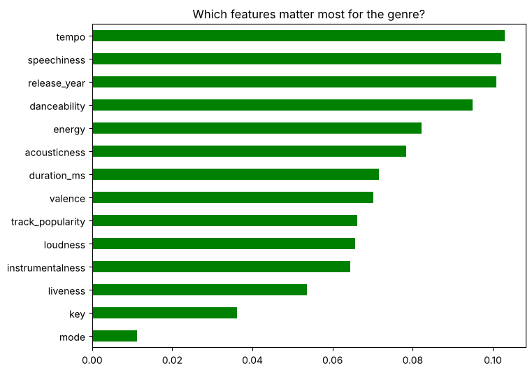

# 🎵 Spotify Songs' Genre Segmentation


Grouping Spotify songs by how they sound with **K-Means clustering**, predicting their genre with a
**Random Forest Classifier**, and using both to build a **song recommendation system**.

📄 **[View the full project report](https://YOUR-USERNAME.github.io/spotify-genre-segmentation/Spotify_Project_Report.html)**  ·
📓 **[Open the notebook](Spotify_RandomForest.ipynb)**

---

## 📌 Objective
Spotify recommends music by grouping songs with similar audio properties. Using the given dataset, this project:
1. Performs data pre-processing
2. Analyses and visualizes the data to find insights
3. Shows the correlation matrix of the features
4. Finds clusters of songs and compares them with playlist genres and playlist names
5. Builds a model and uses it for a recommendation system

## 📂 Dataset
[`spotify dataset.csv`](spotify%20dataset.csv) – 32,833 rows × 23 columns

| Group | Columns |
|---|---|
| Track | track name, artist, popularity, album, release date |
| Playlist | playlist name, genre (edm, latin, pop, r&b, rap, rock), sub-genre |
| Audio features | danceability, energy, key, loudness, mode, speechiness, acousticness, instrumentalness, liveness, valence, tempo, duration |

## 🧹 Data pre-processing
- Dropped **5** rows with missing track name / artist / album
- Removed **4,477** songs repeated across playlists → **28,352** unique songs
- Extracted `release_year` from three date formats and added `duration_min`
- Scaled features with `StandardScaler` before clustering

## 📊 Key insights


- **Rap** has the highest speechiness; rap and latin are the most danceable
- **EDM** has the highest energy and tempo but the lowest valence
- **Rock** is the least danceable; **r&b** is the softest; **latin** is the happiest
- **Pop** and **latin** are the most popular genres

## 🔗 Correlation matrix


Strongest relationships: **energy–loudness (+0.68)** and **energy–acousticness (−0.55)**.

## 🧩 Clustering (K-Means, k = 6)


Each genre and playlist has a main cluster (e.g. rap → speechy cluster, EDM → energetic/instrumental cluster),
but genres overlap in sound.

## 🌲 Model: Random Forest Classifier
Predicts `playlist_genre` from the audio features, popularity and release year (80% train / 20% test).

| Model | Accuracy |
|---|---|
| **Random Forest** | **60.6%** (57.0% without release year) |
| Logistic Regression | 46.9% |
| KNN (k = 5) | 44.9% |
| Naive Bayes | 44.8% |
| Decision Tree | 42.2% |
| Random guessing | 16.7% |

 

Rock and EDM are recognised best; pop and latin are confused most often.

## 🎧 Recommendation system
Combines the Random Forest's genre probabilities with the scaled audio features, keeps songs in the same
K-Means cluster, and returns the closest songs by Euclidean distance.

```python
recommend('Memories')
# If You Don't – Jonah Baker, Renee – SALES, Come Home To Me – LÉON, ...
```

## ▶️ How to run
1. Open `Spotify_RandomForest.ipynb` in [Google Colab](https://colab.research.google.com) (File → Upload notebook)
2. Run the cells in order and upload [`spotify dataset.csv`](spotify%20dataset.csv) when asked

## 🗂️ Files
| File | Description |
|---|---|
| `Spotify_RandomForest.ipynb` | Google Colab notebook with code, explanations and outputs |
| `Spotify_Project_Report.html` | Full project report |
| `spotify dataset.csv` | Dataset |
| `*.png` | Charts used in this README |

## 🛠️ Tools
Python · pandas · NumPy · Matplotlib · Seaborn · scikit-learn · Google Colab
